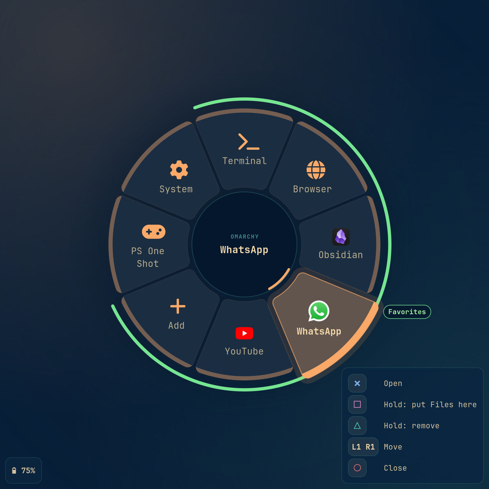
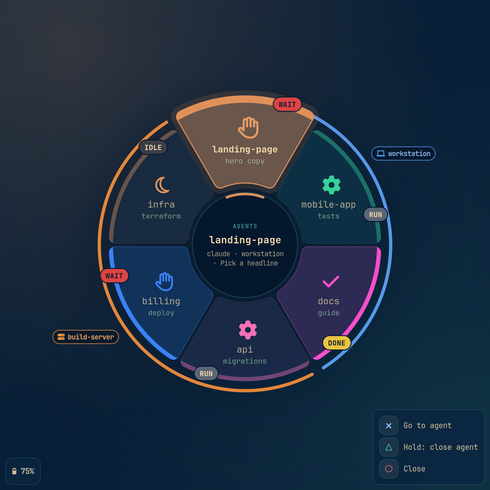
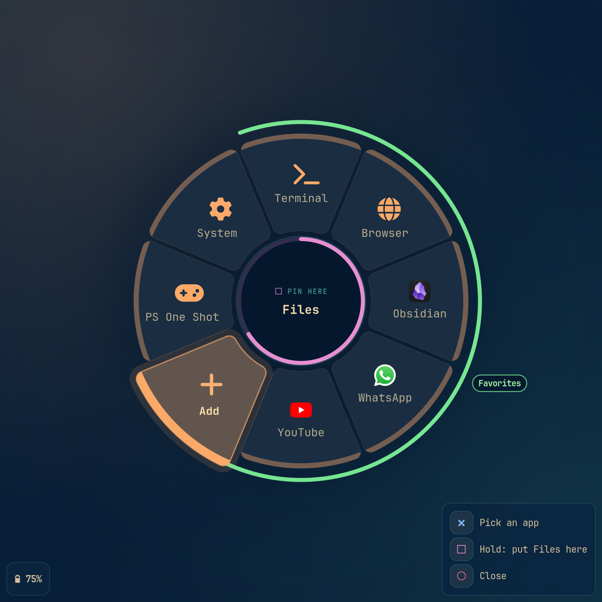
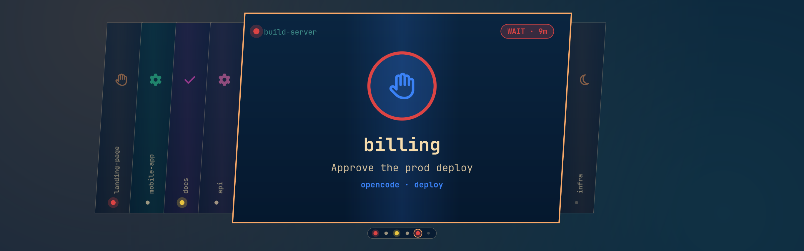
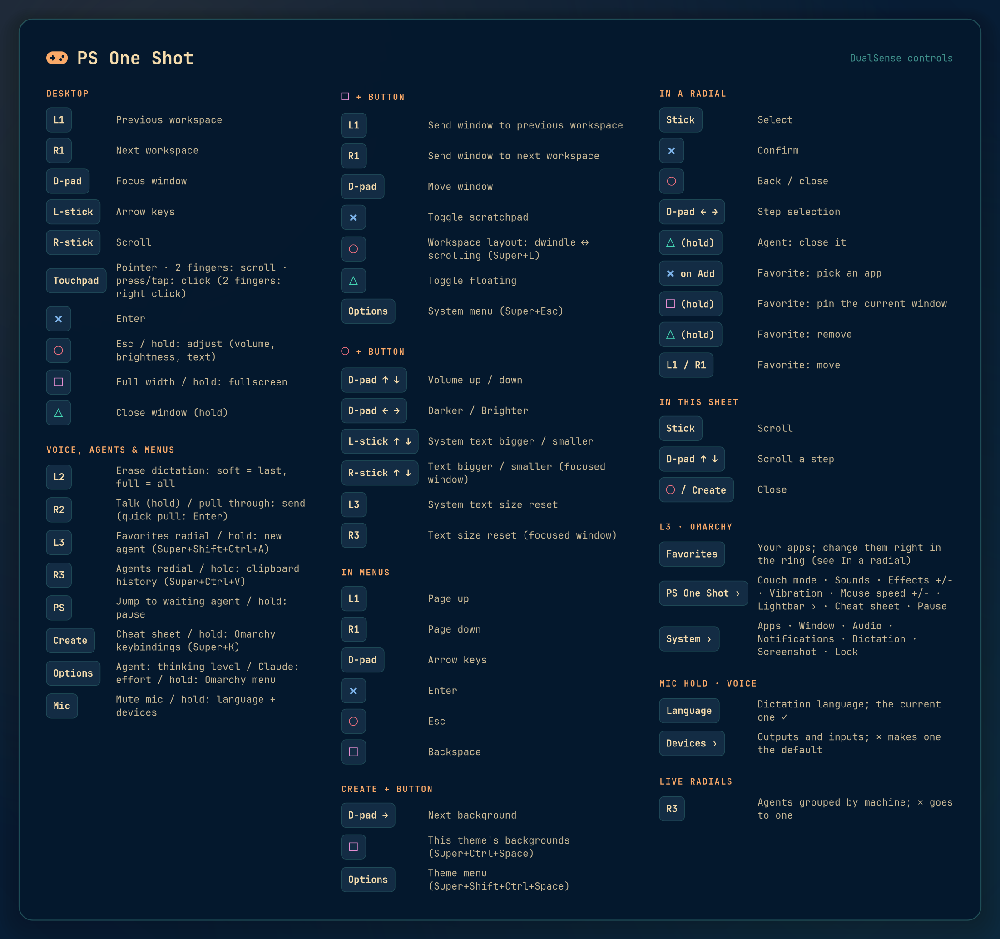

# PS One Shot

Use a PlayStation 5 DualSense to drive a [Hyprland](https://hypr.land) desktop and the AI agents running on it.

<p align="center">
  
  
</p>

With it you can:

- switch workspaces and move between windows,
- open your favorite apps and everything else from radial menus you steer with a stick,
- navigate launcher menus and answer agent prompts (Enter, Escape, arrow keys),
- talk to an agent and fire the prompt off with one pull of R2 — the "one shot",
- take dictation back with the adaptive L2 trigger,
- change an agent's thinking level (Claude Code: effort) from the controller,
- switch the dictation language and audio devices from a radial menu,
- use the touchpad as a mouse,
- see AI-agent status on the lightbar, and feel and hear when an agent needs you.

Works on any Hyprland setup. On [Omarchy](https://omarchy.org) it also uses Omarchy's own menus and commands.

## Features

### Windows and the desktop

- **Workspaces and windows.** L1/R1 step to the previous/next workspace, empty ones included, and the D-pad moves focus. A □ tap makes the window full width (maximized: bar and gaps stay, like Omarchy's Super+Alt+F); hold □ for real fullscreen, which kicks in by itself after about half a second. Hold □ and press another button right away for the window layer: the same buttons then move the window, and on Omarchy ○ switches the workspace layout between dwindle and scrolling (Super+L; also in L3 → System → Window → Layout).
- **On-the-fly adjustments (hold ○).** While ○ is held:
  - D-pad ↑/↓ changes volume, ←/→ screen brightness (laptop backlight, or DDC/CI on external monitors via Omarchy). Hold either to keep going: a slow DDC monitor gets one update at a time, always to the latest value, so it glides instead of lagging behind;
  - the left stick ↑/↓ steps the system text size (Omarchy: the same knob as Text size in its monitor panel, for the shell, GTK apps and terminals; elsewhere GTK's text scaling), and clicking it (L3) resets it. Open foot windows (herdr's terminals) follow right away, even though foot can't reload its config: PS One Shot watches `foot.ini` and zooms each open window by the difference, without focusing it, whoever changed the size;
  - the right stick ↑/↓ zooms just the focused window, for fine-tuning one terminal or page, and clicking it (R3) resets that.

  A short ○ press is still Escape. Window zoom presses the app's own keys on the keypad (Ctrl+Keypad +/−, Ctrl+0; Kitty's Ctrl+Shift ones), which type the same on every keyboard layout. It works in terminals (including herdr's), browsers and editors; L3 → System → Window has Text bigger / smaller / reset too.
- **Couch Coding Mode.** L3 → PS One Shot → **Couch mode** scales the whole screen up by 1.5 (scale 2 → 3), so terminals, browsers, the bar and the overlays all grow for reading from across the room. The bar has less room then, so on Omarchy the `[couch] bar_hide` widgets leave it for the duration (by default Omarchy's own extras: keyboard layout, weather, updates, tray, Tailscale, agents, Bluetooth, monitor) and return to their places afterwards. Switching it off restores your monitor config. `[couch]` also sets the factor, the monitors, and actions to run once the screen has changed (the Omarchy preset restarts VoxType's waveform OSD there so it measures the new size).
- **Menu mode.** While a launcher menu is open (Omarchy menu, rofi, wofi, walker, fuzzel), the D-pad works as arrow keys, ✕ as Enter, ○ as Escape and L1/R1 as Page Up/Down. On Omarchy this covers its pickers too: the theme and background grids, clipboard history, emojis, the keybindings panel and password prompts (`[menu] namespaces`, matched against layer-shell namespaces).
- **Touchpad mouse.** One finger moves the cursor and two fingers scroll. Press the touchpad to click (two fingers pressed = right click, hold and move to drag); a light tap clicks too.
- **Stick scrolling.** The right stick scrolls smoothly, with hi-res wheel events.

### Talking to agents

- **Agent prompts.** ✕ is Enter, ○ is Escape and the left stick sends arrow keys (with auto-repeat), so you can pick options in an agent's prompt and submit it without a keyboard.
- **Talk and shoot (R2).** Hold R2 lightly to dictate (Omarchy: `voxtype`, same as F9); the lightbar pulses fast and red while you talk. Let go to just type the text. Pull through the trigger's click instead to stop and send it: the recording stops right away, and Enter goes in as soon as VoxType has finished typing (it reads VoxType's state file, so a long dictation never gets cut off). A quick pull straight through, with nothing said, just sends what's already typed, like ✕. Every shot kicks back: a hard rumble, and the trigger itself buzzes under your finger for a moment.
- **Take dictation back (L2).** The L2 trigger has a resistance point you can feel (DualSense adaptive trigger):
  - a soft press (before the click) erases the last dictated phrase; press again for the one before it,
  - a full press (through the click) erases everything dictated since the last Enter,
  - with nothing dictated left, a soft press erases a word and a full press clears the line.

  Exact erasing needs the [VoxType hook](#voxtype-dictation-undo); without it L2 still erases words and lines.
- **Thinking level / effort (Options).** A tap works the focused agent's own reasoning control, in its own terms; the agent kind comes from Omaherd. omp and pi: Shift+Tab, the next thinking level. Claude Code calls it effort and has no key for it, so the tap stashes your draft (Ctrl+S), opens `/effort`'s slider, and the draft comes back afterwards: move it with the left stick, ✕ confirms, ○ cancels. Configurable per agent in `[agents]`. Outside an agent window, and on a hold, Options opens the Omarchy menu.
- **Agent status ([Omaherd](https://github.com/salemsayed/omaherd)).** The lightbar shows the most urgent agent: red = waiting for you, yellow = done, each alternating with that agent's own colour (Claude orange, Codex green…), so you can tell who it is before you press PS. Soft breathing in your theme's accent = working; the accent, dimmed = nothing to do. Theme and agent colours go out at their hue's full colour, the way RGB-sync tools light a PC from the theme (a pastel accent would turn lilac on the dimmed LEDs). The five player LEDs count waiting agents; while agents work and none waits, one of them runs back and forth. When an agent starts waiting you get a buzz and a beacon sound. The PS button jumps to the most urgent agent; press again within 4 s to cycle to the next one.
- **Sound effects.** A blaster "pew" when you send a prompt (✕ in an agent window, or an R2 shot), a power-up chirp on a thinking-level change, a beacon when an agent calls. All synthesized; swap any of them for your own file in `[sounds]`. L3 → PS One Shot switches them on and off (`sounds:toggle`) and sets their volume (Effects +/−, `sounds:louder`/`sounds:quieter`), both remembered across restarts. They play on the controller's own speaker, wired or over Bluetooth. Linux has no sound device for the controller over Bluetooth, so there PS One Shot sends the sound to it itself, inside the controller's own HID reports. Adaptive triggers and rumble keep working through it.

### Radial menus



L3 opens your favorites, R3 opens agents, holding the mic button opens voice. Pick a slice with either stick, confirm with ✕, go back with ○. The keyboard works an open ring too: Escape or Backspace goes back, Enter picks, the arrows and Tab step around. Submenus are supported, and every tick has a haptic click. A name too long for its slice scrolls through it while that slice is selected. A panel in the bottom-right corner lists what each button does on the selected slice; the bottom-left one shows the controller's battery.

- **Favorites** (L3) are six slots for what you open most, in fixed places so your hand learns them, next to PS One Shot › and System › (apps, window, audio, notifications, dictation, screenshot, lock). Apps show their own icons, and picking one focuses its open window instead of starting another, web apps included. You change the slots right in the ring, and it remembers them (`[favorites] items` only sets where it starts):
  - ✕ on an empty slot ("Add") picks from a list of every installed app (Omarchy's own menu, or any dmenu-style list).
  - Holding □ pins the app of the window you were in; holding △ empties a slot. While you hold, the centre names what's about to happen and a ring fills up; let go early and nothing changes.
  - L1/R1 move a favorite one slot.
- **Agents** (R3) are grouped by machine: local agents first, then each SSH host, each with its own coloured arc and hostname. Every slice shows the project, its herdr tab (or task title) and a status badge. Going to an agent (here or with PS) brings up the herdr window already showing that session, the most recently used one if there are several, and switches it to the agent. A new terminal opens only when no window shows the session yet. Holding △ on an agent closes it: its herdr pane, here or on the SSH host. As with favorites, the centre names the agent while a ring fills up, and letting go early changes nothing.
- **Agents carousel** (`herd:pick`, or `ps-oneshot agents` from a key binding). The same agents as cards in a carousel that looks like Omarchy's theme switcher, in your theme's colours: the R3 ring's order, opening on the most urgent agent. Each card has its machine, status and how long, project, task and herdr tab; the strips beside it show each agent's icon and project. Every agent has a status dot on its strip, on the card and in a row underneath, and the ones waiting for you blink. Arrows, Tab or the pad (D-pad, a stick, L1/R1 to jump between waiting agents) move, typing filters, Enter or ✕ goes to the agent as R3 does, Escape or ○ closes. On Omarchy, bind it in `~/.config/hypr/bindings.lua`: `o.bind("SUPER + A", "Agents", "ps-oneshot agents")`; pressed again, it closes. Without the daemon running, `ps-oneshot agents` shows the cards in Omarchy's own image selector instead, without the blinking.

  
- **Voice** (hold the mic button) puts the dictation languages straight on the ring (the current one checked) plus a Devices submenu with every output and input; picking a device makes it the default and moves playing streams.
- **PS One Shot** (L3) holds the app's own switches: couch mode, sound effects and vibration on/off (icon, ✓ and on/off show the current state), the effects volume and the touchpad pointer speed (Effects +/−, Mouse +/−; the level shows in the middle of the ring), the cheat sheet and pause, plus a **Lightbar** submenu: colours vivid or as the theme has them, the alert style (✕ steps through alternate, blink and breathe and plays it on the lightbar), brightness and idle glow +/−, and the running light on/off. Sounds, vibration, the steppers and the Lightbar settings keep the ring open for another press and are remembered across restarts. Vibration off silences every rumble and the shot's trigger kick; the triggers' resistance stays.

<br clear="right">

### And also

- **Theme and background (Omarchy, hold Create).** Create + ☰ opens Omarchy's theme menu, Create + □ its background switcher (the current theme's wallpapers), Create + D-pad → steps to the next background. Press the second button right away; a short Create alone is still the cheat sheet.
- **Game mode.** Hold PS to pause everything; Steam games pause the controller automatically. While paused, the lightbar turns dark blue (as it does when PS One Shot stops), and from then on it leaves the LEDs and triggers alone and releases the touchpad.
- **Mic button.** A tap mutes your microphone, a hold opens the voice radial. The button's LED and the controller's own microphone follow the system microphone (lit and cut off = muted), whatever muted it. The kernel flips the controller mic's hardware mute on every press, holds included; PS One Shot puts it back, so dictating into the controller (wired) keeps working. The button is read via hidraw, because the kernel doesn't report it as an input event.
- **Plugging in moves the controller to the cable.** Plugged in while it's on Bluetooth, the controller would stay on Bluetooth, and the microphone and speaker that appear on the cable would stay silent. PS One Shot disconnects Bluetooth and the controller comes back on the cable a few seconds later, microphone and all. In game mode it leaves the controller alone.
- **Cheat sheet.** Press Create to see every binding, the sticks and touchpad, and what's inside each radial menu; ○ or Create closes it. Nothing is cut short: when it's taller than the screen, either stick or D-pad ↑/↓ scrolls it, and a scrollbar shows where you are.
- **Battery.** Every open radial shows the charge in its bottom-left corner, in the 10 % steps the controller reports. Notifications at 20 % and 10 %, plus an orange lightbar blink when the battery is low.

## Default layout

| Control | Desktop | Holding □ | Holding ○ | In a menu |
|---|---|---|---|---|
| L1 / R1 | previous / next workspace (empty ones too) | send window to previous / next workspace | | page up / down |
| D-pad | focus window ← → ↑ ↓ | swap window ← → ↑ ↓ | ↑↓ volume, ←→ brightness | arrow keys |
| Left stick | arrow keys | | ↑↓ system text size (L3 resets) | arrow keys |
| ✕ | Enter | toggle scratchpad | | Enter |
| ○ | Escape (tap) | workspace layout dwindle ↔ scrolling (Omarchy; elsewhere maximize) | | Escape |
| □ | full width (tap) / fullscreen (hold) | | | Backspace |
| △ | close window (hold) | toggle floating | | — |
| L2 | erase dictation: soft = last phrase, full = all since Enter | | | |
| R2 | talk (hold lightly) / send (pull through the click) | | | talk / send |
| L3 / R3 | Favorites radial / Agents radial (on release); hold (Omarchy): new agent / clipboard history | | reset system text / window zoom | |
| Options | thinking level in an agent, effort in Claude Code (tap) / Omarchy menu (hold) | System menu | | |
| Create | cheat sheet (tap) / Omarchy keybindings (hold); held with ☰: theme menu, □: background switcher, D-pad →: next background | | | |
| Touchpad press | left click (two fingers: right click) | | | |
| PS | jump to waiting agent (tap) / pause (hold) | | | |
| Mic | mute microphone (tap) / voice radial (hold) | | | |
| Right stick | scroll | | ↑↓ focused window's text size | |

Buttons with no binding in a layer fall back to the next layer down: menu → □/○ → desktop. That's why talking still works inside a launcher and you can dictate into its search field. □ and ○ act as modifiers only on their own; pressed while the other is held, they do that layer's job (□ held + ○ = layout).

The cheat sheet (Create) is generated from your configuration, so it always shows what your buttons do. With the Omarchy defaults:

<p align="center">
  
</p>

## Install

Requirements:

- Hyprland (Lua config ≥ 0.55 or the classic hyprlang one),
- Python ≥ 3.11 with PyGObject, GTK 4 and gtk4-layer-shell,
- a [Nerd Font](https://www.nerdfonts.com) for the menu icons (Omarchy ships one; without it the menus show text only).

```sh
git clone https://github.com/misza-one/ps-oneshot && cd ps-oneshot
./install.sh          # the minimum
./install.sh --full   # or everything: the minimum plus the optional tools
```

On Arch (and so on Omarchy) `install.sh` installs the missing packages itself, with pacman; elsewhere install PyGObject, GTK 4 and gtk4-layer-shell first. The minimum is all PS One Shot needs to run. Each optional tool brings one feature, and `--full` adds them all:

| Tool | Arch package | What it brings |
|---|---|---|
| `pw-play` | pipewire-audio | sound effects |
| `pactl` | libpulse | the audio devices ring and the mic mute LED |
| `notify-send` | libnotify | notifications |
| `bluetoothctl` | bluez-utils | moving a plugged-in controller from Bluetooth to the cable |
| libopus | opus | sound effects on the controller over Bluetooth |
| `wpctl`, `playerctl`, `brightnessctl` | wireplumber, playerctl, brightnessctl | volume, mic mute, media and brightness keys without Omarchy (Omarchy has its own commands) |
| a Nerd Font | ttf-nerd-fonts-symbols | the menu icons without Omarchy (Omarchy ships one) |

[VoxType](https://voxtype.io) (dictation), [Omaherd](https://github.com/salemsayed/omaherd) and [herdr](https://github.com/herdrdev/herdr) (agent status) aren't in the Arch repositories: install them from their own pages. `--full` reminds you when they're missing, and `ps-oneshot check` lists what's there.

Both ways set up four things:

1. a `~/.local/bin/ps-oneshot` launcher,
2. a systemd user service (`ps-oneshot.service`) bound to `graphical-session.target`,
3. `packaging/70-ps-oneshot.rules`, installed with sudo,
4. the `uinput` kernel module, loaded now and at every boot (`/etc/modules-load.d/ps-oneshot.conf`), when the kernel doesn't have it built in.

The udev rule makes the lightbar and player LEDs writable and gives the seat user access to the controller's hidraw node (mic button, adaptive triggers), its USB device node (moving it from Bluetooth to the cable) and `/dev/uinput`. Reconnect the controller once the rule is installed. Without it, everything works except the LEDs. Pass `--no-udev` to skip the rule, or `--uninstall` to remove everything.

```sh
ps-oneshot check      # config, Hyprland IPC, uinput, optional tools, controller, LED permissions
ps-oneshot devices    # what was found and what is accessible
ps-oneshot -v         # run in the foreground with debug logs
journalctl --user -u ps-oneshot -f
```

## Configuration

Settings load in this order:

1. `ps_oneshot/defaults/base.toml` (generic Hyprland),
2. `ps_oneshot/defaults/omarchy.toml` (when Omarchy is detected),
3. `~/.config/ps-oneshot/config.toml`.

Tables merge and values replace. Lists replace as a whole, so overriding `radial.apps.items` means listing every item you want. All actions and binding forms are documented at the top of `base.toml`. A few examples:

```toml
[bindings.normal]
cross = "wm:cyclenext"                                     # ✕ = Alt+Tab instead of Enter
triangle = ""                                              # remove a default
l2 = { soft = "key:ctrl+z", full = "key:ctrl+a delete" }   # two-stage trigger, any actions

[bindings.window]                                          # while □ is held
dpad_up = { press = "exec:omarchy-audio-output-volume raise", repeat = true }

[sticks]
left = "pointer"                                           # left stick moves the cursor instead of arrows

[triggers]
click_zone = [3, 5]                                        # earlier, lighter click on L2/R2
click_strength = 4

[agents]
thinking = { omp = "shift+tab", claude = "ctrl+s slash e f f o r t enter", codex = "" }

[sounds]
summon = "~/sounds/r2d2.wav"                               # any file pw-play can read; "" = silent

[voxtype]
languages = [{ code = "en", label = "English" }, { code = "pl", label = "Polski" }]

[favorites]                                                # where the L3 ring starts; then edit it in the ring
items = [
  { action = "launch:org.telegram.desktop.desktop" },      # an app: its own name and icon
  { label = "Notes", icon = "\uf249", action = "exec:obsidian" },
]

[radial.apps]
title = "Mine"
items = [
  { label = "Terminal", icon = "\uf120", action = "exec:omarchy-launch-terminal" },
  { label = "Media", icon = "\uf001", items = [
    { label = "Play/Pause", action = "exec:playerctl play-pause" },
    { label = "Next", action = "exec:playerctl next", keep_open = true },
  ] },
]
```

Radial items can also be live: `{ label = "Devices", source = "audio" }`, `source = "voxtype-language"`, `source = "herd"`, `source = "settings"` (PS One Shot's own switches) or `source = "favorites"` (the `[favorites]` slots) build a submenu when you open it, and `inline = true` puts the live choices straight on the ring.

`launch:<desktop id>` (for example `launch:org.gnome.Nautilus.desktop`) focuses that app's open window, or starts it with `[apps] launch` (`uwsm-app` on Omarchy, `gtk4-launch` elsewhere). Favorites use it for every app you add.

`wm:` actions (`workspace`, `focus`, `swap`, `movetoworkspace`, `fullscreen`, `maximize`, `float`, `pin`, `close`, `special`, `cyclenext`, `cycleprev`, `monitor`) work with both Lua-configured Hyprland (≥ 0.55) and the legacy hyprlang dispatchers. PS One Shot detects which one you run.

### VoxType dictation undo

VoxType types text like a keyboard and keeps no history, so PS One Shot needs to see each phrase to erase it exactly. VoxType's `post_process` hook passes every transcription through a shell command before typing it. Use `tee` there: the text goes through unchanged and a copy lands where PS One Shot watches for it:

```sh
voxtype config set output.post_process.command 'tee "$XDG_RUNTIME_DIR/ps-oneshot/dictation"'
systemctl --user restart voxtype
```

This isn't a native VoxType feature, so keep a few things in mind:

- If PS One Shot isn't running, the folder doesn't exist, `tee` fails, and VoxType falls back to typing the original text. Dictation still works, it just isn't recorded.
- The hook replaces any other `post_process` command, such as an LLM clean-up. To keep yours, chain it: `your-command | tee "$XDG_RUNTIME_DIR/ps-oneshot/dictation"`.
- Erasing sends one Backspace per character, scoped to the window you dictated into. If you moved the cursor or typed in between, the count no longer lines up.
- Any other dictation tool works too if it writes each phrase to `dictation.capture_file`.

## Known issues

- **The controller's microphone only works on the cable.** Over Bluetooth the controller can send its microphone, but inside the same packets that carry its buttons, and the kernel driver reads every one of them as buttons: sticks and buttons would jump at random for every program. So PS One Shot doesn't use it there. Plug the cable in, and PS One Shot moves the controller over to it (see Features).
- **Bluetooth sound is reverse-engineered.** Over Bluetooth the controller takes Opus-encoded audio in an undocumented HID report (0x36), which PS One Shot builds itself. It needs the system's libopus and is tested on the original DualSense only. It plays the built-in sounds and 16-bit WAV files; any other file plays on your normal output instead (`[sounds] device = "controller"` keeps it silent). A controller firmware update could change the protocol.
- **Other programs' rumble stops while the lightbar animates.** The controller ends a running rumble on any output report without its rumble-mode bit, and the kernel's lightbar updates don't carry it. PS One Shot holds its lightbar animation while its own rumble plays, but it can't see other programs' rumble. Games are fine: in game mode it leaves the lightbar alone.
- **Thinking level is cycled blind.** Agents don't publish their current thinking level, so the controller sends the agent's "next level" key and the same power-up sound plays every time.
- **OpenRGB fights over the lightbar.** If OpenRGB (or a tool built on it) also detects the controller, both write the lightbar and colours flicker or mix. Disable OpenRGB's "Sony DualSense" detector.
- **Steam Input.** With Steam running and its desktop controller configuration enabled, Steam turns the controller into a mouse/keyboard as well. Disable the desktop configuration or quit Steam.
- **Leaving couch mode reloads the Hyprland config.** That is what restores every monitor exactly, including settings a runtime rule can't read back (ICC profiles, reserved areas). The catch: changes made at runtime with `hyprctl keyword`/`eval` are reset too. Omarchy keeps its toggles and workspace layouts in files, so those survive.
- **Monitor-profile daemons undo couch mode.** hyprmoncfgd (and similar) notice the scale change within seconds and re-apply their profile. Pause them with `[couch] enter`/`exit` actions (example in `base.toml`).
- **Third-party bar widgets stop while couch mode hides them.** Omarchy only runs third-party widgets that are on the bar, so whatever a hidden one does (a radio, a chat you summon) pauses until couch mode ends. Its own `omarchy.*` widgets just hide; that's why the default `bar_hide` only lists those.
- **`key:` actions press physical keys at their US-layout positions.** With another keyboard layout, a symbol key types whatever that layout puts there; on a German layout `key:minus` types ß. Letters mostly survive (QWERTZ swaps Y and Z, AZERTY swaps more). That's why text zoom uses the keypad +/−, which are the same on every layout.
- **□ pins only windows that an installed app owns.** A window is matched to its `.desktop` entry by class: the entry's `StartupWMClass` or desktop id, or for a web app the host of its URL. Windows that share one class can't be told apart: Omarchy's TUIs all run as `TUI.float` or `TUI.tile`. Add those from the list instead; they then start a new window each time rather than focusing the open one.

## How it works

One Python process runs one GLib main loop and needs no dependencies beyond PyGObject. It reads the controller through evdev (stdlib `ioctl`, no python-evdev) and the mic button through hidraw. It drives the LEDs via the kernel `hid-playstation` LED class and rumble via force feedback. The adaptive trigger effects and the mic mute (LED plus the microphone's hardware mute) go out as raw hidraw output reports that set only their own fields, so they don't interfere with the kernel driver. While a rumble plays, they also carry the controller's rumble-mode bit: any report without it stops the rumble, which is also why the lightbar animation waits until PS One Shot's own rumble is over. Sounds are synthesized once into `~/.cache/ps-oneshot` and played with `pw-play`. Over Bluetooth they're Opus-encoded instead (the system libopus, through ctypes) and sent to the controller in HID report 0x36, one frame every 10.667 ms, the controller's audio clock. That protocol was reverse-engineered by [LinuxAudio4Dualsense5](https://github.com/GeorgLegato/LinuxAudio4Dualsense5); PS One Shot implements it from that documentation, with a state section that sets nothing but the rumble-mode bit. Hyprland is reached over its IPC sockets. The overlays are GTK 4 layer-shell surfaces that never take clicks; the radial and the agents carousel hold the keyboard only while open. The game controller itself is never grabbed, so other apps still see it; only the touchpad is grabbed while PS One Shot is active.

## Development

```sh
python -m unittest discover -s tests
python -m tools.fake_dualsense --settle 2 tap:BTN_THUMBL sleep:1 stick:ABS_X:255 sleep:1 tap:BTN_EAST
python -m ps_oneshot.ui.demo
python -m tools.screenshots      # redraw the pictures in docs/images (run it in a desktop session)
```

`tools/fake_dualsense.py` creates a virtual DualSense through uinput: a gamepad plus a touchpad, and it accepts rumble. You can drive it from a script to test without hardware. `tools/screenshots.py` draws the overlays offscreen with made-up apps and agents. [AGENTS.md](AGENTS.md) describes the architecture, conventions and how to test safely next to a real controller.

## Credits

PS One Shot stands on these projects:

- [Hyprland](https://hypr.land), the compositor it drives,
- [Omarchy](https://omarchy.org), whose menus, themes and commands the Omarchy preset uses,
- [VoxType](https://voxtype.io) for dictation,
- [Omaherd](https://github.com/salemsayed/omaherd) and [herdr](https://github.com/herdrdev/herdr) for agent status and agent windows,
- [GTK 4](https://www.gtk.org), [gtk4-layer-shell](https://github.com/wmww/gtk4-layer-shell) and [PyGObject](https://pygobject.gnome.org) for the overlays,
- [PipeWire](https://pipewire.org), [Opus](https://opus-codec.org) and [BlueZ](https://github.com/bluez/bluez) for sound and Bluetooth,
- [Nerd Fonts](https://www.nerdfonts.com) for the icons.

What the controller doesn't document comes from other people's work:

- the Linux kernel's [`hid-playstation`](https://github.com/torvalds/linux/blob/master/drivers/hid/hid-playstation.c) driver: the output report layout and its checksum,
- [LinuxAudio4Dualsense5](https://github.com/GeorgLegato/LinuxAudio4Dualsense5): the Bluetooth speaker protocol,
- [dualsense-neo](https://github.com/forgerpl/dualsense-neo): its notes on the Bluetooth microphone.

## License

[MIT](LICENSE)
